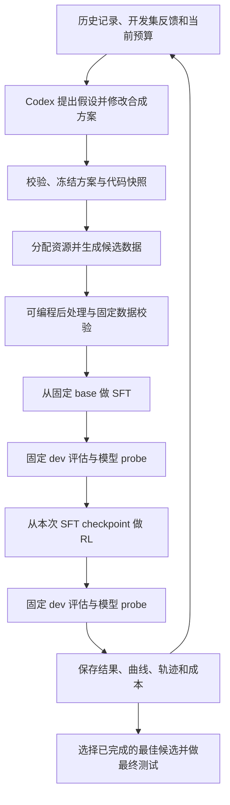

# 自主数据合成 Agent 闭环：现状审计与实现设计

日期：2026-10-19。状态：待评审设计，本文中的新接口、目录和配置均为拟议实现。

本文审查当前工作区（含尚未提交的修改）和 `/home/hrh/RSIBench-Data-main.zip`，不代表只审查 Git HEAD。此次只新增本设计文档；未修改运行代码、未调用付费模型、未启动训练。

## 1. 结论与推荐方向

当前仓库有训练评估积木，也有一个规则驱动的外层迭代雏形，但尚未形成用户要求的 Codex 自主研究闭环。建议在 DataEvo 下增加 session/attempt 执行层，以 DataObs 的较新实现作为首批训练和合成适配器，逐步替代 DataEvo 中重复且落后的复制代码。

RSIBench-Data 的核心工作区契约值得借鉴：数据 Agent 能写合成代码、提交训练数据、调用固定实验入口、查看分数和轨迹、在预算内继续迭代。保留这里的本地 GPU + verl SFT→GRPO 能力，借鉴它的 attempt、profile、反馈、预算和 final selection；不要求照搬 Tinker/E2B。

第一条垂直链路用 GSM8K 验证完整闭环；公共数据模型从第一天支持多轮轨迹。第二条用可执行的 terminal 任务验证 agentic 合成和 SFT；第三步接通同一种任务的多轮 RL。Harbor 负责 agentic 任务执行/评估，RL 另有明确的环境与 token 对齐适配，不能把 Harbor Job 当作现成的 RL trainer。

## 2. 当前仓库到底有些什么

| 用户需要的能力 | 代码证据 | 判断 |
|---|---|---|
| 蒸馏、SFT、SFT 评估、GRPO、GRPO 评估 | `DataObs/scripts/experiment_pipeline.py`、`experiment_pipeline_vllm.py` | 有按阶段执行的实现；本次未验证真实训练运行 |
| 可选择多种合成/蒸馏方法 | `DataObs/scripts/experiment_pipeline.py:24` 的 `DISTILL_METHODS` | 已有 7 种方法，见下文 |
| 根据训练反馈修改下一轮参数 | `DataEvo/scripts/dataevo_pipeline.py:196`、`DataEvo/lib/controller.py` | 有规则控制循环，不是完整的自主研究 Agent |
| LLM/Codex 能调整整个实验方案 | `DataEvo/lib/prompt_agent.py:93` 的 output contract | 当前外部 LLM 主要输出 `prompt_suffix/rationale`，后缀限制 900 字符；未提供完整 Codex harness |
| 动态选择蒸馏方法、改完整模板、编写后处理 | DataEvo `stage_distill()` 固定调用 correctness-filter 脚本 | 外层没有这些正式动作；DataObs 的方法选择未自动接入 DataEvo |
| 保存训练日志与动态摘要 | `DataEvo/lib/training_dynamics.py`，训练脚本 WandB offline | 有；曲线工具存在，但不是每轮统一产出的反馈包 |
| 利用 SFT/RL 后模型主动 rollout 分析 | eval runner、离线分析工具 | 有采样/评估积木，没有统一的按 checkpoint 主动 probe 服务和回灌动作 |
| `(完整 setting, SFT 表现, RL 表现)` 实验记忆 | `manifest.json`、`history.jsonl`、逐轮策略与 dynamics | 有初步记录，尚缺一致的代码快照、数据哈希、比较契约和完成态管理 |
| 自动分配 API/GPU、预算与故障恢复 | GPU ID 参数、外部 prompt 命令 | 仅显式传参；未发现资源租约、统一 API 计量和持久任务调度 |
| agentic 数据训练 | `MultiTurnSFTDataset`、SGLang multiturn 示例 | 底层有多轮能力，DataObs/DataEvo 主链尚未接通任务环境、验证器和完整 agentic RL |

DataObs 已有的方法：`teacher_correctness_filter`、`question_rephrasing`、`answer_augmentation`、`question_augmentation`、`reverse_thinking`、`self_instruct`、`cot_self_instruct`。并非仅支持 GSM8K；已有数学、选择题、代码等数据集入口，但这些入口不等于通用 agentic 环境。

### 2.1 实现上的具体限制

1. **默认闭环不包含独立模型评估。** `dataevo_pipeline.py:121` 默认 `distill,metrics,sft,grpo`，没有 `sft_eval,grpo_eval`。可以手动加，但默认配置不会自动得到这两个阶段的独立分数。
2. **可选读取不等于自动计算。** `training_dynamics.py:238/262/360` 从约定路径读取评估、pass@K、SDS、headroom、template 和 recovery 文件；多数文件没有对应的每轮自动生成阶段。没有文件时应保留“缺失”，不能解释为分数为零。
3. **难度和长度目前主要是提示词控制。** `difficulty_mix/reason_length_mix` 经 dominant profile 转成字符串再影响 prompt；没有实现真实的按比例分桶合成和基于学生成功率的难度筛选。对固定原题说“生成更难的推理”也不能让题目本身变难。
4. **LLM 的行动空间过小。** 规则 controller 先决定参数，prompt agent 主要补后缀。不能把训练后自主分析、代码生成和实验规划都等同于这个 prompt agent。
5. **两套 pipeline 已发生漂移。** DataObs 有新方法 registry 和新参数，DataEvo `stage_distill()` 仍是较早的固定逻辑。继续复制会扩大兼容性维护成本。
6. **核心代码未被 Git 跟踪。** `git check-ignore -v DataEvo/lib/controller.py` 指向 `.gitignore:31:lib/`；`git ls-files DataEvo` 没有 `DataEvo/lib`。本机能 import 不代表全新 clone 能运行。未来实现时应明确纳入这些源文件，不在本次评审直接修改用户已有改动。
7. **训练/评估切分需要重设。** 当前 SFT val 默认回退到训练文件，GSM8K RL val 默认使用官方 test；自动反复读取 test 并据此优化，会让 test 成为开发集。新系统必须在训练数据中划分 train/dev/probe，最终 test 保持独立。
8. **逐轮失败即终止，缺少任务恢复。** 外层 `run_round()` 非零即退出；内层可选择阶段和 checkpoint，但没有完整的去重、租约和 durable job 管理。

### 2.2 本次检查的实际边界

- 2026-10-19 约 13:58（北京时间）检查本机进程、仓库工作目录进程和 GPU 进程，未发现属于本仓库的合成、SFT、RL 或评估作业；GPU 上有其他项目的进程。这仅是本机当前快照，不覆盖远程集群任务。
- 已执行两轮外层 dry-run，输出在 `/tmp/cot-rsibench-review.wwZZ05/dataevo-dryrun/review_only/`；确认能生成策略、命令、历史及缺失诊断占位。
- 该 dry-run 的 `run_round()` 直接返回，没有真正调用内层训练脚本，不能证明训练端到端可用。
- 已检查内层 CLI help 和关键调用关系；未运行 GPU 训练、Harbor/E2B 或付费 API。

## 3. RSIBench-Data 的实现与取舍

审查对象是用户给定的 zip，不是同机器的其他 RSIBench checkout。zip 注释中的提交号为 `4c807610243e7b481d382c5ed360c71c79a22f61`，SHA256 为 `da4aff30d86d77fab152eba8061b787da0d5422c2b78a702f1fd1d0e15f8bf04`。

解压检查目录：`/tmp/cot-rsibench-review.wwZZ05/RSIBench-Data-main/`。

### 3.1 它确实在做数据迭代

```text
runner/run_session.sh
  → 根据 benchmark spec 创建 Agent 工作区、参考资料与固定命令
  → Codex / Claude Code / Kimi 进入工作区写数据生成代码
  → attempts/<id>/train_messages.jsonl + 可选 run_config.json
  → run_attempt.sh：验证格式、运行环境和预算预估
  → pipeline/run_chain.sh：Tinker LoRA SFT → sampler checkpoint
  → backend/e2b_eval：模型代理 → Harbor agent → E2B 任务环境 → verifier
  → 分数、错误、轨迹、token/cost、timings、budget state
  → Agent 读取反馈，自主修改方法并提交新 attempt
  → final_submit.sh 选择完成且有效的 checkpoint
```

关键文件：

| 文件（相对解压根目录） | 可参考之处 |
|---|---|
| `runner/run_session.sh` | 工作区建立、生成 run_attempt/final_submit 命令、调用固定 pipeline |
| `runner/lib/codex_harness.sh` | `codex exec --json`，保存末条消息，resume/reprompt，截止时间控制 |
| `runner/lib/validate_agent_run_config.py` | Agent 输入白名单，固定评估超参，拒绝未知参数 |
| `runner/lib/update_budget_state.py` | 已完成/失败 attempt、费用、分数、best attempt |
| `runner/lib/validate_final_selection.py` | 只允许提交真实执行过且有效的 attempt |
| `benchmarks/*/spec.json` | benchmark 的任务族、agent scaffold、评估形状与参考合成库 |
| `backend/e2b_eval/e2b_eval.py:133` | Harbor `JobConfig` 绑定模型端点、agent、dataset、环境与并发 |
| `runner/workspace_template/profiles/*/DATA_GENERATION.md` | 要求从真实来源、执行结果和反馈构建合成数据 |
| `runner/workspace_template/profiles/*/*DATA_FORMAT.md` | 训练轨迹和被评估 agent 的实际交互格式保持一致 |

### 3.2 它并未直接完成本需求的所有部分

- 固定链只有 **LoRA SFT → Harbor 评估**，没有 GRPO/RL 阶段。不能把它描述成已经提供 SFT→RL 闭环。
- Harbor 是评估/运行层，数据生成策略主要由数据 Agent 自己写。压缩包里的 `seed_factories` 多数是空的 Git submodule 占位，只能核实引用和说明，未从这个 zip 审查到 SWE-smith/tmax 等库的内部实现。
- API 调用用途分开：决策 Agent 的 API、合成 rollout API、Tinker 训练/采样。README 明确合成 API usage 不扣 Tinker 预算；不能直接当成“所有资源都在一个硬预算下”。
- 它提供固定评测轨迹供诊断，但没有这里拟议的统一主动 probe 接口，也没有本地 GPU 的独占租约管理。
- `train_on_all_assistant` 默认 false，训练器默认只取最后一个可训练 assistant turn；打开它会为多个 assistant turn 构建样本。多轮操作任务必须显式确认训练哪些动作，否则可能主要学到最后的提交消息。
- 其训练 JSONL 允许四种 role，但 `content` 要是非空字符串；这不是无损的通用原生 tool-call schema。终端 profile 用 assistant JSON command 文本、user terminal output，这与原生 `tool_calls` 是两种序列化方式。
- 它反复使用官方评估形状来优化，适合其基准协议；我们的研究循环推荐另设 dev/probe/final test，以衡量泛化。
- “参考 pipeline 不可改”、前台执行等部分来自运行约定；不应据此推断它已提供所有进程隔离、预算硬限制或并发锁保证。

### 3.3 对原计划的调整

采用 RSIBench 的 **Agent 工作区 + attempt 提交契约 + 固定训练评估器 + 轨迹反馈**。把现有 rule controller 降为诊断建议/初始 baseline，Codex 可自主采纳或反驳，并记录证据。资源与训练预算由执行器控制。

保留本地 GPU/verl，训练后模型用本地 serving adapter；环境后端可选本地容器或 E2B。GSM8K 先用现有轻量 evaluator，避免为每条算术题建立 Harbor sandbox。terminal/SWE 等需要环境的任务再接 Harbor。

## 4. 系统边界：谁可以改变什么

系统中有两种不同角色：

- **数据研究 Agent（Codex）**：修改数据合成策略、代码和模板，读取反馈，决定下一轮尝试什么。
- **被训练的目标 Agent/模型**：教师生成轨迹，学生经过 SFT/RL 后在固定 scaffold 中做任务；这是被评估对象。

Codex 可以修改：teacher/model 选择（在资源池范围内）、采样参数、合成方法及其组合、完整教师推理模板、任务生成器、学生失败导向的采样、数据配比、后处理代码。后处理可做正确性、去重、diversity、难度和轨迹质量筛选，也可以是自定义多阶段程序。

固定执行器负责：数据校验、资源租约、训练 profile、评估集和解码配置、标准训练预算、checkpoint 导出、指标计算、结果入库。最终评估 oracle、指标分母和官方数据划分由执行器持有。

允许自定义“筛选正确性函数”，但它的输出是数据选择信号；不能替代固定的最终评估 verifier。教师推理模板可以改变；学生训练/评估的外部工具协议保持一致。

第一版每个 session 同时只运行一个 attempt，但支持多个 session 在不同租约上运行。后续并行多个候选时不改变 attempt 契约。

## 5. 公共运行流程



训练算子可标准化；每种任务族固定一个版本化 profile。GSM8K 的 GRPO profile 和 terminal 的多轮环境 profile 不需要使用相同代码参数，但都遵守相同的训练/评估结果契约。

每轮默认从同一 base 开始 SFT，再从本轮 SFT checkpoint 做 RL，用于比较“数据策略的效果”。下一轮可以使用前一轮学生做诊断或数据生成。若研究持续训练，则显式开启另一个 `initialization_mode=continue` session，记录父 checkpoint，分开排行榜。

RL 训练任务集第一版保持固定，仅优化冷启动 SFT 数据。若要同时优化 RL 任务，另启版本化 profile 并声明该自由度，避免混淆改进来自哪里。

## 6. 可审阅的目录与接口草案

下列内容是设计，尚未创建对应运行文件。

```text
DataEvo/
  runtime/
    session.py             # 外层生命周期、恢复、截止时间
    codex_harness.py        # 启动/继续 Codex，保存事件和最终决策
    attempt_runner.py       # 固定阶段执行、快照和结果汇总
    resources.py            # GPU/API/环境资源租约
    registry.py             # 单写入端 SQLite、状态迁移与 artifact 索引
    contracts.py            # Session/Attempt/Dataset/Feedback 版本化契约
  adapters/
    generation/            # 现有方法的包装、API/local teacher 接入
    training/              # DataObs SFT/GRPO 包装、checkpoint 导出
    tasks/                 # gsm8k、terminal、后续 swe/tool-use
    environments/          # 本地容器、E2B 等运行后端
    evaluation/            # 现有 evaluator、Harbor adapter
    serving/               # 模型端点生命周期与 probe
  profiles/                # 固定训练/评估协议
  workspace_template/      # Agent 工作约定与合成代码示例
  scripts/run_session.py   # 新公共入口
```

Agent 拥有的 workspace 和执行器拥有的结果目录分开：

```text
<session>/
  workspace/
    research.md
    attempts/a000/
      hypothesis.md
      recipe.yaml
      templates/teacher.jinja
      synthesize.py
      postprocess.py
  runner/
    session.sqlite
    snapshots/a000/         # 冻结的输入、代码、依赖和配置摘要
    attempts/a000/
      candidates/
      dataset/             # 保留、拒绝原因、质量统计和 lineage
      sft/  rl/
      eval/sft/  eval/rl/
      probes/sft/  probes/rl/
      metrics/             # step JSONL/CSV + summary + curves
      feedback.json
      result.json
    leaderboard.json
    selected.json
    final_test/
```

真实运行时目录访问边界由进程/容器挂载落实，不能仅靠目录命名宣称隔离。SQLite 为受控执行器所有，Agent 通过查询命令读历史。

### 6.1 Agent 可以调用的操作

```text
status()                                   → 当前任务、租约、预算、排行榜
history(filters)                           → 已完成及失败候选和对应证据
validate_attempt(attempt_id)               → schema、格式、资源和成本预检
submit_attempt(attempt_id)                 → 冻结输入并返回 durable job_id
get_job(job_id)                             → 当前阶段、事件和日志位置
get_feedback(attempt_id)                   → 标准反馈和轨迹索引
probe_model(checkpoint_id, probe_spec)      → 有预算的诊断 rollout
select_attempt(attempt_id)                 → 选择有效候选，执行固定 final test
```

这些先实现成一个 CLI 的子命令，Agent 通过 shell 使用；以后可封装 MCP，但不是第一版必要条件。提交后 runner 持有长任务，Codex 会话结束或网络断开不影响 GPU job。Agent 可等待/查询，不自行启动无人管理的训练进程。

Codex 的非交互接入用官方 `codex exec`、JSONL 事件和结构化输出；会话恢复使用明确的 session 标识，实验记忆以磁盘/数据库为准，不只依赖对话。具体 CLI flag 在实现时按已安装版本检查。

官方参考：https://developers.openai.com/codex/noninteractive （本次读取的页面支持脚本运行、JSON 事件、结构化结果和 resume）。不硬编码模型版本；决策 Agent 的认证和教师采样端点分别配置。

### 6.2 一个候选 recipe

以下 YAML 是**拟议 schema 示例**。参数只表示 Agent 行动空间，不是已证实更优的实验设置。

```yaml
schema_version: 1
attempt_id: a002
parent_attempt_id: a000
hypothesis: 增加经验证的中等难度解题路径，改善 RL 后的覆盖面
task_profile: gsm8k_v1
train_profile: gsm8k_sft_grpo_v1
generation:
  entrypoint: synthesize.py
  methods: [teacher_distill, question_rephrasing]
  teacher: teacher_pool/math_teacher
  template: templates/teacher.jinja
  sampling:
    temperature: 0.85
    top_p: 0.95
    samples_per_task: 4
    max_new_tokens: 4096
postprocess:
  entrypoint: postprocess.py
  config:
    correctness: verified
    diversity: stratified_clusters
    difficulty: measured_student_success
resources:
  generation: {gpu_count: 1}
  training: {gpu_count: 2}
  max_generation_tokens: 2000000
```

recipe 中的方法名供追踪，真正可扩展性来自版本化 entrypoint，不把 Agent 永久锁在枚举方法里。Agent 也可只复用内置方法。训练数据上限、RL rollout token/step 预算和评估参数来自固定 profile，不能通过 recipe 偷换。被截断的轨迹、未知 gold 和未验证的候选必须显式标注。

### 6.3 自定义代码契约

生成和后处理都在独立进程中执行，通过 artifact 路径通信，不要求动态 import Agent 的任意代码到 runner 主进程。

```text
synthesize.py --context context.json --output candidates.jsonl
postprocess.py --input candidates.jsonl --context context.json --output selected.jsonl
```

context 提供数据源引用、允许访问的教师/学生服务句柄、资源限制和随机种子，不写入 API secret。每条输出保留 sample_id/task_id/source_id、父样本、方法与模板版本、候选验证结果。后处理必须输出逐条保留/丢弃原因和配比统计。

固定校验器检查：协议完整性、真实来源/执行引用、重复/切分冲突、可训练 token 数、合法动作顺序、上下文长度和数据量。数据选择的内部启发式由 Agent 自主决定；固定最终评估定义不随候选改变。

## 7. 从 GSM8K 到 agentic 数据

### 7.1 公共数据模型

统一分成两个对象，而不是把所有任务压成 question/answer：

**TaskSpec**：task_id、task_family、source_group/split、instruction、environment_ref、tool_schema/scaffold_ref、verifier_ref、资源/超时约束、可见任务材料。训练用 oracle 和评估用 oracle 分离；不把测试脚本内容注入目标模型上下文。

**Trajectory**：trajectory_id、task_id、policy/checkpoint、messages/actions、真实 observations、episode/result、reward、终止原因、token/turn 数、逐 assistant turn 的训练 mask/权重、运行与验证证据引用。需保留原生 tool call 的 id、name、arguments、result 关联，不只存可读文本。

映射关系：

| 层次 | GSM8K | terminal / SWE / tool-use |
|---|---|---|
| Task | 数学题及 gold | 环境初态、任务说明、工具、隐藏检查器 |
| Trajectory | 一段 assistant 解答 | 多次 assistant action → 环境 observation → 修正与验证 |
| Verification | 固定答案抽取/计算检查 | 实际执行检查器、状态/文件/API 断言 |
| SFT | prompt/response 或单轮 messages | 训练所有选中的 assistant 动作；环境输出默认不计 loss |
| RL | 同题采样组与答案 reward | 相同可重置环境的多条 on-policy episode、终态 reward |
| Feedback | 错题类型、答案覆盖、长度 | 工具选择、命令错误、恢复能力、过早结束、验证遗漏 |

GSM8K 仍可用现有 parquet writer，但从公共 Task/Trajectory 导出。terminal/SWE 导出多轮 messages 与工具协议；不能只训练最后一句“已完成”。现有 `MultiTurnSFTDataset` 可以复用，逐消息自定义 mask/权重和 tool-call 渲染必须补兼容性检查。

### 7.2 agentic 数据合成应生成什么

推荐从“有真实文件和确定性验证的小型 terminal 数据处理任务”起步：例如格式转换、数据清洗、构建与调试，要求查看文件、运行程序、读取错误、修正和校验输出。第一版任务规模可以小，但不能把虚构命令输出当作真实交互。

任务合成链：

```text
公开非评测来源/已有训练源
  → Codex 编写任务构造器与初态材料
  → 建立环境与 verifier
  → 检查：空操作失败、参考解通过、错误/变异解失败
  → 教师在真实环境中执行并记录轨迹
  → verifier 验证 + trajectory replay 检查
  → correctness/diversity/difficulty 后处理
  → 多轮 SFT 数据 + 可重新 reset 的 RL TaskSpec
```

diversity 应覆盖任务族、工具与状态转换、错误恢复路径，而不只是措辞去重。difficulty 用固定学生 probe 的经验成功率、步数与资源需求估计；估计使用的模型/checkpoint 与采样数入库，不能把教师口述的“hard”直接当真。

真实可恢复的失败片段可以用于自纠错训练，但需要保留上下文并验证最终结果；未经验证的失败轨迹不标成成功示范。任务和 verifier 同由 Agent 生成时，要运行基线负例、变异检查及抽样复核，降低自证正确的风险。

### 7.3 Harbor 的位置

Harbor adapter 把 TaskSpec 导出为任务包：`instruction.md`、`task.toml`、`environment/`、`tests/`，并按需要保留仅运行侧可见的 reference solution。评估时固定 agent scaffold（例如 mini-swe-agent 或 terminus-2）、模型 endpoint、工具解析器、上下文限制和 checker 版本。

教师合成和学生评估可在同类任务 runner 上执行，但训练任务与评估任务、source group 必须分开。Harbor 的完整结果保留为原始证据，再映射到公共 Trajectory，不假设每种 agent 输出格式相同。

本地容器与 E2B 都可作为环境后端；先确定本机可用后端，再实现相应 adapter，不将 RSIBench 中 E2B 的配置直接当作本地实现。

### 7.4 agentic RL 的单独工程工作

Harbor evaluation 通常通过一个独立 serving endpoint 让已保存模型完成任务；RL 需要训练器当前策略的 token、mask、logprob 和权重同步。两者不能简单通过“读取 Harbor 成功轨迹”替代。

拟议的环境桥：

1. 每组 GRPO rollout 用同一个 task 初态与 seed reset 多个环境；限制并发及每回合最大 turn/token/time。
2. verl/SGLang 多轮 rollout 在当前 actor 下生成动作，环境执行后把 observation 追加到上下文。
3. 只对 actor 生成的 token 计算 policy loss；工具/环境输出 mask 为零，保持动作序列和 logprob 严格对应。
4. episode 结束后由运行侧 verifier 给终态 reward；任务失败、格式错误、超时与基础设施失败分别编码。
5. 保存训练 rollout 的 task/trajectory/reward/checkpoint 引用，供反馈读取。基础设施失败不直接解释为数据学习失败。

复用点是当前仓库 `examples/sglang_multiturn/`、`verl/workers/rollout/sglang_rollout/` 和交互配置接口；完整 terminal/SWE 环境生命周期与 reward 接线需要新实现和真实验证。若某个 profile 尚无 RL adapter，配置预检明确拒绝完整链，不用 SFT 代替 RL 报成功。

## 8. 反馈如何真正改变下一轮决策

每轮必须同时给 Agent 三类反馈：

1. **可比较的结果**：base/SFT/RL 的固定 dev 指标、任务族分数、SFT→RL 增益、预算消耗和不确定性；最终目标默认是固定预算下的 RL 后 dev 表现。
2. **训练动态和数据统计**：SFT loss/val loss、RL reward、entropy、KL、clip、grad、response truncation，候选保留率、正确率、长度、重复和难度分布。解释指标定义，reward/accuracy 分开，不将 reward proxy 自动当作准确率。
3. **行为证据**：模型主动 probe、固定诊断 panel、失败/成功轨迹样本、verifier 细节和覆盖/退化对比。

`probe_model()` 可以指定本 session 的任一合法 checkpoint 和 train/probe 数据源，选择采样参数、任务切片和 rollout 数量。在预算内允许新探测；不能访问 final test。每个结果标记 checkpoint、任务集合、采样参数和证据来源，避免比较不同解码配置产生的假增益。

固定 panel 默认对 base/SFT/RL 用同一批 probe tasks 和同一采样设置做覆盖比较；base 结果按模型/数据/profile/seed 缓存。数学题可报告 empirical pass@1 和明确定义的 pass@K；对 agentic 任务报告 success rate、steps、tool/format failures 和耗时。多次尝试若不独立，不宣称是无偏 pass@K。

训练指标优先输出结构化 step JSONL/CSV，沿用已有日志 parser 作为兼容输入。统一生成曲线和可读报告，同时提供机器可读 `feedback.json`；昂贵的 K=16、entropy/headroom 诊断按预算启用，缺失显式写 null/reason，不用零代替。

每个下一轮 `hypothesis.md` 至少回答：依据哪些结果/轨迹；修改了什么；预期修复什么；可能损害什么；如何验证。Agent 可以回到历史最佳候选分叉，也可复用旧数据与新数据混合。系统记录这个分叉关系，不强制每轮只能接上一轮。

例如：RL 成功率下降且命令错误占比上升，可能尝试减少未经 replay 验证的命令轨迹并增加经验证的恢复轨迹；不能简单硬编码成“entropy 降就提高 teacher temperature”。相关性只用于提出假设，需由下一次受控实验验证。

## 9. 实验记忆、资源和恢复

### 9.1 每条记忆保存完整因果条件

```text
attempt_id + parent_attempt_id + hypothesis
recipe + 代码/模板快照哈希 + 数据来源/切分/数据集哈希
base/teacher/tokenizer/checkpoint/scaffold/verifier 版本
固定 SFT/RL/eval profile + seed + 实际训练/rollout token 数
候选/保留数据量与实际 token 数 + 各筛选步骤统计
SFT dev + RL dev + probe/curve/trajectory artifact 索引
运行状态 + 失败类型 + API/GPU/环境成本 + Agent 决策理由
```

查询可得到“哪些 setting 对某个任务族有效”“SFT 改善但 RL 退化的候选”“收益/成本最好且验证完整的候选”。recipe 名称不足以复现，必须有代码、依赖与数据快照。历史最佳和最后一次结果分开。

同类候选采用固定训练 token/step 上限和相同评估协议；同时展示实际消耗。数据量本身可作为搜索变量，但对比表必须显示，必要时做等 token 对照。先用单 seed 搜索，再对候选优胜者多 seed 重复，避免将小样本噪声直接解释为改进。

### 9.2 用户只需提供资源池和 session 约束

- 决策 Agent 的 Codex 配置/认证。
- 合成教师 API 或本地模型池；独立的 endpoint、model、并发/RPM/TPM 与费用上限。
- 可用 GPU ID/UUID 及可用时间；候选模型的 TP/显存要求。
- 任务 profile、固定 base、训练预算、总时间和输出位置。
- agentic 任务的环境后端与并发限额。

资源管理器按阶段申请/释放：本地 teacher → 训练 → 导出模型 → eval/probe，默认避免同卡 serving 与训练竞争。API 教师不占本地生成 GPU。每个阶段设置 token/时间/并发上限，并在启动前预留训练、评估、probe 和最终测试预算。模型池不存在合适资源时返回等待/不可行原因，不能只按 teacher registry 顺序盲目升级。

第一版 GPU allocator 用跨 session 共享锁/lease、设备 UUID 和实际占用预检；`CUDA_VISIBLE_DEVICES` 是可见性设置，不能代替独占保证。只清理自己持有的进程、服务和环境。API 调用通过受控网关统一计量；若要硬预算，运行进程只能使用受控凭证/出口，不能把任意脚本自报 usage 当硬限制。决策 API、合成 API、学生 rollout 和环境/GPU 消耗分别核算再汇总。

### 9.3 持久任务与恢复

```text
DRAFT → VALIDATING → GENERATING → FILTERING → SFT_RUNNING
      → SFT_EVALUATING → RL_RUNNING → RL_EVALUATING
      → DIAGNOSING → COMPLETED
```

任何阶段可进入 FAILED/CANCELLED；资源等待单独标记 WAITING，不当作模型失败。runner 事务式领取任务并持有 lease/heartbeat；同一 attempt 的冻结版本只能提交一次，重试引用相同 snapshot。

阶段完成需要退出状态、必要 artifact、指标 schema 和 checkpoint 完整性均验证。训练成功但评估失败应保留 checkpoint，恢复时从失败阶段继续。OOM/服务错误允许有限次数恢复；配置与数据错误返回 Agent 修复，新方法变动创建新 attempt。取消或超时由 runner 处理自己拥有的进程树和环境，释放租约；不能误杀他人的 GPU 作业。

## 10. 实施顺序与验收

| 阶段 | 实施范围 | 验收要求 |
|---|---|---|
| A：审计和统一入口 | 修复 DataEvo 源码跟踪问题；包装 DataObs；固定版本化 train/eval profile 与数据切分 | 干净 checkout 能导入；明确训练依赖；dry-run 命令和输入契约可检查 |
| B：GSM8K 完整闭环 | Codex harness、attempt runner、API/GPU 分配、可编程合成/后处理、SFT→RL→eval→probe、历史 | 一次启动后自主完成至少两个候选；第二个依据首个反馈改代码或 setting；保存真实 SFT/RL 分数、曲线、rollout；能选历史最佳 |
| C：运行可靠性 | durable job、资源/预算、阶段恢复、统一指标和快照 | Agent 中断后任务仍被管理；恢复不重复训练；失败不记为成功；预算计量可核对 |
| D：agentic 合成与 SFT | terminal task factory、真实环境轨迹、verifier、Harbor eval、多轮 SFT exporter | 轨迹能 replay、检查器能拒绝空操作和错误产物；SFT 对选定 assistant 动作训练；学生真实完成任务 |
| E：agentic 完整闭环 | verl/SGLang 环境桥、多轮 RL、当前 actor rollout、reward/mask、行为反馈 | 同一个 terminal profile 跑通 SFT→RL→固定评估→主动 probe→下一轮；工具输出不计 policy loss；复现任务初态 |

阶段 B 不是只接 prompt API：验收必须包含 Codex 写/改后处理代码、调用受控实验入口、读取模型行为后再做下一轮决策。阶段 E 完成才称“通用 agentic 数据的 SFT+RL 自主迭代”可用。

## 11. 建议用户评审的关键取舍

1. **研究对象**：第一版只改变冷启动 SFT 数据，RL 训练集与训练预算固定；是否另开同时优化 RL 任务的实验方向。
2. **训练初始化**：默认每个候选从同一 base 重训；持续训练模式独立比较。
3. **目标指标**：默认以 RL 后固定 dev 成功率为主，SFT 指标、探索覆盖和成本为辅助；是否需要其它排序目标。
4. **首个 agentic 域**：推荐 terminal/data-processing 小任务族；如果最终目标是 SWE，也可以直接选择公共非评测代码库上的 issue/test 任务，但环境成本更高。
5. **基础设施**：优先本地 GPU/verl；agentic 环境用本地容器还是 E2B 由机器条件和用户资源决定。

这些取舍已在上文按推荐默认值展开，可直接逐项调整后再实现。
